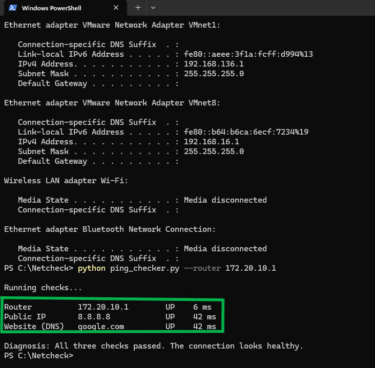
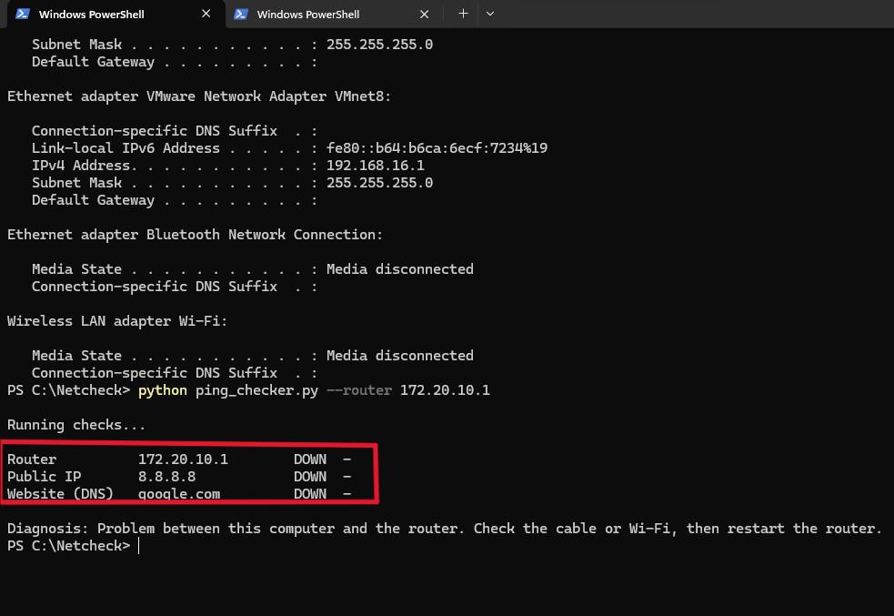

# Network Ping Checker

A small Python script that checks whether a connection problem is with the computer, the router, the internet provider, or DNS. It automates the ping steps from my [IT Support Troubleshooting Guide](https://github.com/boakye-eb/it-support-troubleshooting-guide).

## What it does

It pings three targets in order and prints a plain-English diagnosis:

| Check | Target | What a failure means |
|-------|--------|----------------------|
| Router | your router's IP (e.g. `192.168.1.1`) | The problem is between this computer and the router |
| Public IP | `8.8.8.8` | The router works, but the internet is unreachable (often the provider) |
| Website name | `google.com` | The internet works by IP, so the problem is DNS |

## Requirements

- Python 3.8 or newer
- No extra packages (standard library only)
- Windows, macOS or Linux

## How to run

```
python ping_checker.py
```

It asks for your router's IP address. You can also pass it directly and save the results to a CSV file:

```
python ping_checker.py --router 192.168.1.1 --log results.csv
```

To find your router's IP on Windows, run `ipconfig` and look for **Default Gateway**.

## Example output

**Healthy connection**



Tested on a phone hotspot connection

```
Router          172.20.10.1        UP     6 ms
Public IP       8.8.8.8            UP    42 ms
Website (DNS)   google.com         UP    42 ms

Diagnosis: All three checks passed. The connection looks healthy.
```

**Wi-Fi turned off**



Tested on a phone hotspot connection

```
Router          172.20.10.1        DOWN  -
Public IP       8.8.8.8            DOWN  -
Website (DNS)   google.com         DOWN  -

Diagnosis: Problem between this computer and the router. Check the cable or Wi-Fi, then restart the router.
```

## How it works

1. `ping()` runs the system `ping` command 4 times (`-n` on Windows, `-c` on macOS/Linux) and averages the reply times.
2. `diagnose()` combines the three results using the same logic as the guide: router first, then the internet, then DNS.
3. With `--log`, each run is appended to a CSV file so you can compare results over time.

## What I learned

- How computers translate website names into numeric addresses, and how to measure how fast signals travel across the internet.
- How to make your code run computer commands automatically to see if websites or devices are online.
- How to spot if the problem is coming from your computer, router or ISP.

## Ideas for next steps

- Check several websites instead of one
- Run the checks repeatedly and alert when a target goes down
- Add a timestamped log chart
